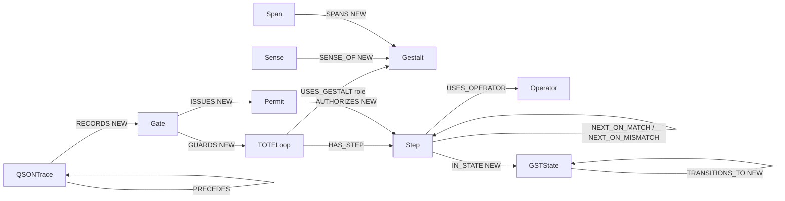

# Ontology map
Fields marked **NEW** are proposed (not in any repo yet). Everything else is from `03_poc/poc.py` or gst/qson/mgate-keeper (`gate_id`, `state_id`, `trace_id`, `qson_version`, `scope`).

| Node | Key | Status |
|---|---|---|
| Gestalt, Sense, Span, Operator, TOTELoop, Step | see 01_schema | existing (poc.py) |
| Gate | gate_id, result | existing names (mgate-keeper/poc TraceEvent) |
| Permit | permit_id NEW, gate_id, scope, expires_at NEW | NEW node |
| GSTState | state_id (gst) | NEW node in KG |
| QSONTrace | trace_id, run_id, sequence, event_type, previous_event_hash, qson_version | maps poc `TraceEvent` |
