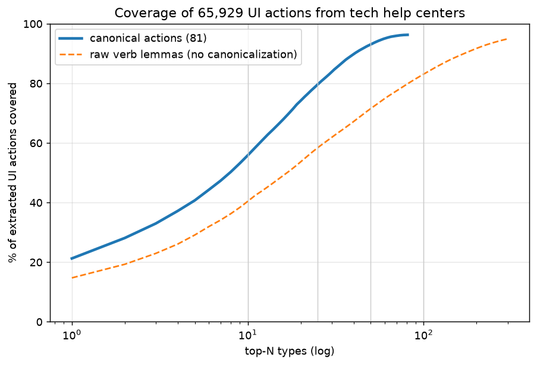

# Coverage report (2026-11-02)

Extracted UI actions: **65,929** (non-action verbs excluded: 3797); distinct verb lemmas: 1435; canonical actions used: 81; unmapped: 3.7%.

| top-N | canonical coverage % | raw verb-lemma coverage % |
|---|---|---|
| 10 | 55.9 | 40.4 |
| 25 | 79.7 | 58.4 |
| 50 | 93.1 | 71.6 |
| 100 | 96.3 | 83.1 |
| 150 | 96.3 | 88.6 |

Actions by site: microsoft 33943, claude 9785, google_chrome 5745, google_youtube 5395, google_android 5281, google_gemini 4893, apple 887

## Top 25

| # | canonical | count | % | top surface verbs |
|---|---|---|---|---|
| 1 | TAP_OR_CLICK | 14015 | 21.26 | select, tap, click, choose |
| 2 | VERIFY_STATE | 4532 | 6.87 | see, check, make, ensure |
| 3 | NAVIGATE_TO | 3206 | 4.86 | find, go, navigate, locate |
| 4 | SELECT_ITEM | 2781 | 4.22 | select, choose, pick, highlight |
| 5 | PROMPT_AI | 2333 | 3.54 | ask, chat, provide, give |
| 6 | CREATE_ITEM | 2328 | 3.53 | create, start, make, build |
| 7 | USE_FEATURE | 2007 | 3.04 | use, apply, utilize, leverage |
| 8 | SHARE_SEND | 1950 | 2.96 | share, send, email, text |
| 9 | OPEN_ITEM | 1898 | 2.88 | open, access, view, show |
| 10 | SET_VALUE | 1781 | 2.7 | manage, set, adjust, configure |
| 11 | EDIT_ITEM | 1680 | 2.55 | change, edit, fix, customize |
| 12 | TYPE_TEXT | 1518 | 2.3 | enter, type, write, complete |
| 13 | REVIEW_CONTENT | 1395 | 2.12 | read, review, refer, preview |
| 14 | INSTALL_APP | 1201 | 1.82 | add, install, reinstall, get |
| 15 | FOLLOW_PROMPTS | 1157 | 1.75 | follow, continue, repeat, proceed |
| 16 | CONNECT_DEVICE | 1108 | 1.68 | connect, join, link, plug |
| 17 | TOGGLE_ON | 1089 | 1.65 | turn, enable, allow, activate |
| 18 | DELETE_ITEM | 1058 | 1.6 | delete, remove, clear, erase |
| 19 | OPEN_APP | 1058 | 1.6 | open, run, start, launch |
| 20 | OPEN_SETTINGS | 830 | 1.26 | open, go, access, launch |
| 21 | MEDIA_PLAYBACK | 828 | 1.26 | video, play, watch, stop |
| 22 | REFRESH_RELOAD | 745 | 1.13 | try, refresh, retry, reload |
| 23 | CONTACT_SUPPORT | 728 | 1.1 | contact, report, reach |
| 24 | SEARCH | 651 | 0.99 | search, look, query |
| 25 | LONG_PRESS | 641 | 0.97 | hold, touch, press, tap |

## Top unmapped verbs

ctrl (72), distribute (26), bring (23), monitor (23), offer (22), collaborate (19), autofill (19), participate in (18), unpin (18), shortcut (17), retrieve (17), handle (16), reach (16), log (16), deselect (15), extend (15), live (15), attempt (14), begin (14), become (14), act on (14), translate (14), engage (14), cause (13), merge (13)

## Numbered-list steps only (25,260 actions)

top-10: 69.5% | top-25: 86.2% | top-50: 96.8% | top-100: 98.9% | top-150: 98.9%

Spot-check (40 random actions, agent-graded, PENDING HUMAN REVIEW): see spotcheck_40.csv
