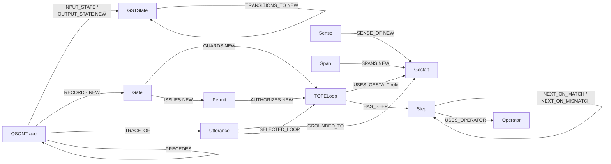

# Ontology map
**Single source:** `stages/02-schema/output/schema.cypher`. `ontology.json` is generated from it. This page is the human view. **NEW** = proposed here, not in any source repo.

| Node | Fields from | Notes |
|---|---|---|
| Gestalt, Sense, Span, Operator, TOTELoop, Step, Utterance | poc / TOTE DB / nych registry | `Gestalt.origin` NEW |
| Gate | g8son schema: gate_id, order, type, conditions, outcomes; file_id (g8son root) | |
| Permit | mg8-runtime runtime.py: id→permit_id, run_id, proposal_id, status, purpose, expires_at, version, epoch, evaluation_digest, actor, operation | |
| GSTState | gst spec: state_id, gst_version, internal, external, continuity, intent, outcome_expectation, constraints | nested objects stored as JSON strings |
| QSONTrace | qson schema event fields; actor split to actor_type/actor_id | replaces TraceEvent |

**Sense/Span → Gestalt linking:** registry `gestalt` values are glyphs. Only `✅` matches a TOTE-DB Gestalt glyph; the other registry glyphs get a Gestalt node with `origin='registry_glyph'` (NEW) so every Sense/Span is connected.
